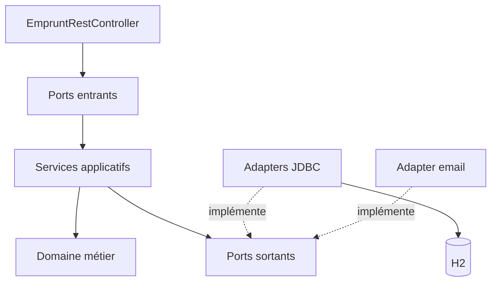

# MédiaTech — application legacy

L'application de gestion des prêts de la médiathèque de Villeneuve, version 1.
Elle fonctionne… mais plus personne n'ose la modifier.

## Lancer l'application

Rien à installer : la base de données (H2) est en mémoire et les emails s'affichent dans la console.

Dans IntelliJ, ouvrez `MediatechApplication` et cliquez sur le **triangle vert** à côté de `main`
(ou onglet **Maven → Plugins → spring-boot → spring-boot:run**).

| Quoi | Où |
|---|---|
| Essayer l'API (Swagger) | http://127.0.0.1:8080/swagger-ui.html |
| Voir les tables (console H2) | http://127.0.0.1:8080/h2-console — JDBC URL : `jdbc:h2:mem:mediatech`, utilisateur `sa`, pas de mot de passe |
| Voir les emails envoyés | la console d'IntelliJ (encadrés « 📧 EMAIL (simulé) ») |

La base est **recréée à chaque démarrage** : relancez l'application pour retrouver les données de départ.

> ⚠️ Utilisez **127.0.0.1** et pas `localhost` : avec `localhost`, le navigateur peut envoyer trop de cookies (laissés par d'autres projets) et l'application répond **400 Bad Request**.

## Essayer l'API

Dans Swagger, ouvrez `emprunt-controller`, choisissez une opération, cliquez sur **Try it out**,
remplissez les paramètres puis **Execute** :

| Opération | Paramètres | Ce qui se passe |
|---|---|---|
| `POST /api/emprunts` | adherentId = 1, exemplaireId = 3 | Alice emprunte Germinal → 200 |
| `POST /api/emprunts` | adherentId = 3, exemplaireId = 1 | Chloé a déjà 3 emprunts → 409 |
| `POST /api/emprunts` | adherentId = 4, exemplaireId = 1 | Damien est suspendu → 403 |
| `POST /api/retours` | exemplaireId = 2 | Bruno rend Dune, réservé par Alice → regardez l'email dans la console |

## Lancer les tests

Onglet **Maven → Lifecycle → test**, ou triangle vert à côté d'une classe de test.

## Les données de démonstration

| Adhérent | Situation |
|---|---|
| 1 — Alice | Étudiante, aucun emprunt, a réservé *Dune* |
| 2 — Bruno | Standard, a emprunté *Dune* (exemplaire 2) |
| 3 — Chloé | Standard, 3 emprunts dont un en retard |
| 4 — Damien | Standard, suspendu pour encore 5 jours |

## Architecture hexagonale — emprunts et retours

Les cas d’usage d’emprunt et de retour sont migrés vers `com.mediatech.emprunt`.
Les contrôleurs adhérents, réservations et le batch de relance restent dans le legacy.

### Ports et adapters

- `Adherents` : lecture et persistance des adhérents et de leurs emprunts ; implémentation `AdherentsJdbc`.
- `Exemplaires` : lecture et mise à jour du statut ; implémentation `ExemplairesJdbc`.
- `Reservations` : recherche du premier réservataire par date ; implémentation `ReservationsJdbc`.
- `Notificateur` : ports de confirmation et d'avertissement ; implémentation `NotificateurEmail`.
- `EmprunterDocument` et `RendreDocument` sont les ports entrants appelés par `EmpruntRestController`.

### Choix d'architecture

- **Transactions :** `TransactionTemplate` enveloppe les deux cas d'usage dans `MediatechConfig`, sans annotation Spring dans le domaine ou les services.
- **Coordonnées :** l'adapter email demande prénom et email au port `Adherents`; le domaine ne connaît pas les coordonnées personnelles.
- **Règle R7 :** au retour, l'adapter cherche le premier réservataire en triant `date_reservation`; si une réservation existe, l'exemplaire est mis en statut `RESERVE` et le réservataire est notifié.
- **Erreurs :** les erreurs métier sont traduites par `ErreursApi`. Les adhérents ou exemplaires inconnus et les retours sans emprunt restent en HTTP 500 pour conserver le comportement du legacy durant le refactoring.
- **Périmètre :** `AdherentController`, `ReservationController` et `RelanceBatch` restent en legacy, comme demandé.

### Vérification de l'architecture

Le test ArchUnit est situé dans `src/test/java/com/mediatech/architecture/ArchitectureTest.java`.
Lancez `mvn test` pour exécuter les tests de caractérisation et les règles d'architecture.
